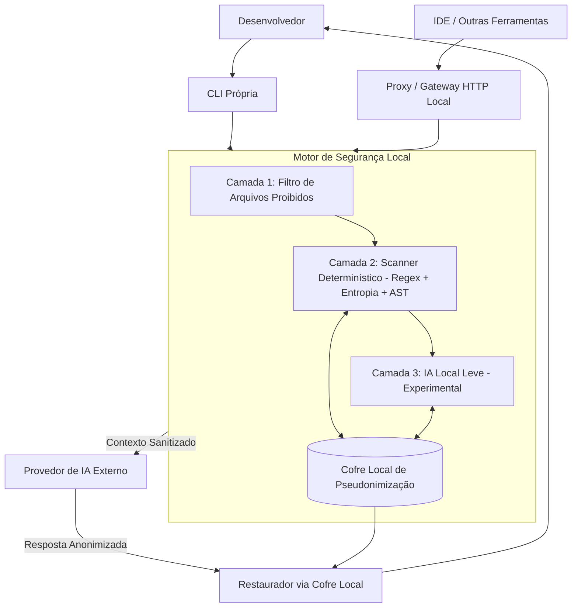

# blind-ai

> Motor híbrido de segurança e privacidade (CLI + Proxy/Gateway local) para desenvolvimento assistido por IA de terceiros sem vazamento de credenciais, arquitetura interna ou dados sensíveis.

## Problema

Engenheiros de software precisam enviar contexto de código para modelos de linguagem externos (LLMs) para depurar, refatorar e desenvolver mais rápido. Porém, esse fluxo cria riscos críticos de **vazamento de dados corporativos**:

- Chaves de API, tokens, senhas e arquivos `.env`.
- Caminhos internos de diretórios, nomes de servidores e endereços IP privados.
- Nomes de módulos proprietários, regras de negócio e dados sensíveis em comentários ou logs.

## Visão da Arquitetura

O `blind-ai` adota uma arquitetura modular de **Defesa em Profundidade**, onde um único núcleo de segurança (`core`) atende tanto uma **CLI própria** quanto um **Proxy/Gateway HTTP local**:



## Estrutura do Projeto

```text
blind-ai/
├── docs/
│   └── 01-pesquisa-e-hipoteses.md   # Pesquisa de mercado, método científico e métricas
├── src/
│   └── blind_ai/                    # Código-fonte do motor (Core, CLI e Proxy)
├── tests/                           # Testes automatizados e dataset sintético
├── .gitignore
└── README.md
```

## Status Atual

- [x] Fase 0: Pesquisa de mercado, definição do problema, hipóteses científicas e estrutura inicial.
- [ ] Fase 1: Dataset sintético de avaliação (*benchmark*) e Camada 1/2 (Scanner determinístico + Cofre local).
- [ ] Fase 2: CLI própria (`blind-ai scan` / `blind-ai run`).
- [ ] Fase 3: Experimento científico — Código determinístico vs. IA local leve (SLM/NER).
- [ ] Fase 4: Proxy/Gateway HTTP local e integração ponta a ponta.

## Documentação

- [01 — Pesquisa de Mercado, Hipóteses e Plano Experimental](docs/01-pesquisa-e-hipoteses.md)
