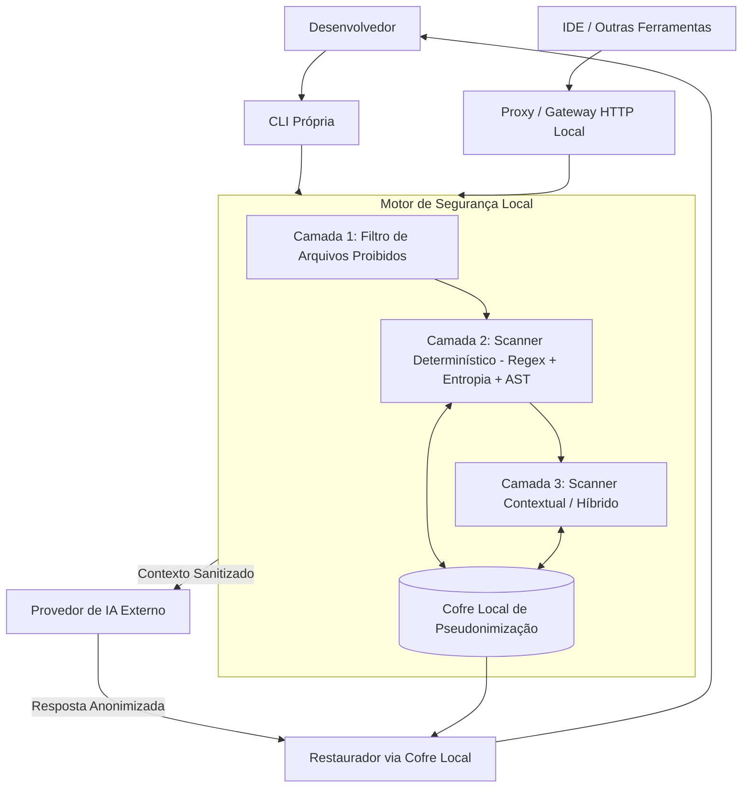

# blind-ai

> Motor híbrido de segurança e privacidade (CLI + Proxy/Gateway local) para desenvolvimento assistido por IA de terceiros sem vazamento de credenciais, arquitetura interna ou dados sensíveis.

## Problema

Engenheiros de software precisam enviar contexto de código para modelos de linguagem externos (LLMs) para depurar, refatorar e desenvolver mais rápido. Porém, esse fluxo cria riscos críticos de **vazamento de dados corporativos**:

- Chaves de API, tokens, senhas e arquivos `.env`.
- Caminhos internos de diretórios, nomes de servidores e endereços IP privados.
- Nomes de módulos proprietários, regras de negócio e dados sensíveis em comentários ou logs.

## Visão da Arquitetura

O `blind-ai` adota uma arquitetura modular de **Defesa em Profundidade**, onde um único núcleo de segurança (`core`) atende tanto uma **CLI própria** quanto um **Proxy/Gateway HTTP local**:



## Instalação

O `blind-ai` requer **Python >= 3.12** e possui **zero dependências externas** (100% biblioteca padrão do Python):

```bash
pip install -e .
```

Após a instalação, o comando `blind-ai` (ou `python -m blind_ai`) fica disponível no terminal.

## Guia de Uso

### Fluxo 1 — CLI de Empacotamento Seguro (`pack` / `apply` / `restore` e `scan`)

Ideal para enviar o repositório inteiro como contexto para qualquer LLM (chat web, CLI ou API) e aplicar as alterações retornadas pela IA diretamente no projeto:

1. **Definir a passphrase via variável de ambiente (evita expor a senha no histórico do shell):**

   ```bash
   export BLIND_AI_PASSPHRASE="sua-senha-forte"
   # PowerShell: $env:BLIND_AI_PASSPHRASE = "sua-senha-forte"
   ```

2. **Empacotar e sanitizar o repositório inteiro com cofre cifrado (`0600`):**

   ```bash
   blind-ai pack . \
     -o context_bundle.md \
     --vault .blind_session.vault \
     --max-tokens 120000 \
     --max-file-bytes 1000000 \
     --case-insensitive-terms
   ```

   - Usa `HybridScanner` (Camadas 2 e 3: AWS, OpenAI, Anthropic, Google `AIza`, Stripe, Slack, GitHub, JWT, credenciais em URLs `postgres://` e `https://`, chaves PEM inline, Bearer tokens, atribuições multi-linguagem JS/TS/Go/Rust/YAML, IPs privados RFC 1918, caminhos internos e comentários sensíveis).
   - Bloqueia automaticamente arquivos sensíveis (`.env`, `*.pem`, `*.key`, binários), symlinks externos e lockfiles/minificados (`package-lock.json`, `yarn.lock`, `pnpm-lock.yaml`, `poetry.lock`, `Cargo.lock`, `*.min.js`, `*.min.css`).
   - Substitui todos os achados e `proprietary_terms` por placeholders determinísticos (`__BLIND_*__`) compartilhando o mesmo cofre entre todos os arquivos.
   - Use `--json` para obter o resumo estruturado da execução.

3. **Aplicar automaticamente no projeto os arquivos alterados pela IA (`apply`) ou restaurar um arquivo único (`restore`):**

   ```bash
   # Aplica blocos Markdown "### `caminho/arquivo.py`" retornados pela IA direto no projeto
   # (com proteção anti-RCE bloqueando escrita em .git/, .agents/, .vscode/, .cursor/, conftest.py, setup.py, .env, etc.)
   blind-ai apply resposta_ia.md \
     --vault .blind_session.vault \
     --target-dir .

   # Ou restaurar um único arquivo/texto
   blind-ai restore resposta_ia.py \
     --vault .blind_session.vault \
     -o codigo_restaurado.py
   ```

4. **Auditoria pré-commit (lendo direto do índice Git via `git show :<path>`) e benchmark:**

   ```bash
   # Escanear conteúdo exato staged no git e falhar (exit code 1) se houver vazamentos
   blind-ai scan --staged --strict

   # Sanitizar um arquivo ou stdin isoladamente
   blind-ai sanitize app.py --vault session.vault -o app.sanitized.py

   # Executar o benchmark sintético (métricas H1)
   blind-ai benchmark --format json
   ```

### Fluxo 2 — Proxy/Gateway HTTP Local para IDEs (`blind-ai proxy`)

Para integração transparente com IDEs (Cursor, Continue, Cline) e SDKs compatíveis com OpenAI (`/v1/chat/completions`, com suporte a JSON, streaming SSE e `tool_calls`):

```bash
export BLIND_AI_UPSTREAM_API_KEY="sk-sua-chave-real-do-provedor"

blind-ai proxy \
  --port 8765 \
  --auth-token "meu-token-local" \
  --upstream-url "https://api.openai.com/v1" \
  --default-session-id "default" \
  --session-ttl 3600
```

Configure sua IDE ou cliente para apontar o `Base URL` para `http://127.0.0.1:8765/v1` com header `Authorization: Bearer meu-token-local` (e opcionalmente `X-Blind-AI-Session-Id: minha-sessao`). O gateway:
- Sanitiza automaticamente `messages[*].content` e `tool_calls[*].function.arguments` na ida e repassa `Authorization: Bearer $BLIND_AI_UPSTREAM_API_KEY` ao provedor upstream.
- Restaura placeholders na resposta JSON e em streaming SSE (com `StreamRestorer` de janela deslizante).
- **Hardening ativo (V1–V6)**: restrição de escopo de restauração anti-oráculo (só restaura placeholders efetivamente enviados na requisição atual), bloqueio de CSRF cross-origin (`Origin` / `Sec-Fetch-Site` / `text/plain`), proteção contra DNS Rebinding (validação de `Host`), limite de 256 sessões ativas e timeout de socket.

Endpoints locais disponíveis:
- `GET /health` — verificação de saúde do servidor local.
- `POST /v1/chat/completions` — gateway compatível com OpenAI (JSON, SSE streaming e `tool_calls`).
- `POST /v1/sanitize`, `POST /v1/restore`, `POST /v1/proxy/echo` — endpoints diretos de sanitização e restauração por sessão.

## Configuração (`.blindai.toml`)

Crie um arquivo `.blindai.toml` na raiz do projeto (descoberto automaticamente pelos comandos da CLI ou informado via `--config`):

```toml
# Termos de negócio, codinomes ou módulos proprietários a pseudonimizar
proprietary_terms = [
  "ProjectHelios",
  "NexusLedgerEngine",
]

# Valores explicitamente permitidos (ignorados pelo scanner)
allowlist_values = [
  "127.0.0.1",
  "example_public_token",
]

# Padrões adicionais de arquivos bloqueados pela Camada 1
extra_blocked_files = [
  "*.bak",
  "secrets/*.json",
]

# Regras regex customizadas do projeto
[rules]
internal_ticket = "ACME-[0-9]{5}"
corp_service_id = "svc_[a-z0-9]{12}"
```

## Estrutura do Projeto

```text
blind-ai/
├── docs/
│   └── 01-pesquisa-e-hipoteses.md   # Pesquisa de mercado, método científico e métricas
├── src/
│   └── blind_ai/
│       ├── core/                    # Scanner, FileFilter, Vault, SecureVault, Packer, Config, Benchmark
│       ├── cli/                     # CLI (`scan`, `sanitize`, `restore`, `pack`, `apply`, `proxy`, `benchmark`)
│       └── proxy/                   # Proxy/Gateway HTTP local compatível com OpenAI
├── tests/                           # 144 testes unitários, adversariais, E2E e auditoria de segurança (V1-V6)
├── pyproject.toml                   # Empacotamento Python >= 3.12 (zero deps externas)
├── .gitignore
└── README.md
```

## Resultados Experimentais e Métricas Alcançadas

Todas as hipóteses científicas definidas em [01 — Pesquisa e Hipóteses](docs/01-pesquisa-e-hipoteses.md) foram validadas em tempo de execução e documentadas em [02 — Resultados Experimentais, Latência e Economia de Tokens](docs/02-resultados-e-metricas.md):

### 1. Experimento Científico H1 vs. H2 (Determinístico vs. Híbrido)

| Motor / Camada | Recall (Cobertura) | Precision (Precisão) | Falsos Positivos (FP) | Latência Média | Meta da Hipótese |
| :--- | :---: | :---: | :---: | :---: | :---: |
| **H1 — `DeterministicScanner` (Estruturados)** | **100,0%** | **100,0%** | 0 | **0,17 ms/arq** | Recall $\ge 95\%$ e $< 100\text{ ms}$ (**Aprovada**) |
| **H1 — `DeterministicScanner` (Global c/ Comentários)** | 66,7% | 100,0% | 0 | 0,32 ms/arq | Demonstra limite em vazamentos contextuais |
| **H2 — `HybridScanner` (Camada 2 + Camada 3 Contextual)** | **100,0% (+33,3%)** | **100,0%** | 0 | **0,42 ms/arq** | Reduzir FN contextuais sem perder precisão (**Aprovada**) |

### 2. Benchmark Adversarial Multi-Linguagem e Código Real (Fora do Dataset)

| Suíte de Avaliação | Escopo | Recall | Precision | Taxa de Falso Positivo (FPR) | Latência / Resultado |
| :--- | :--- | :---: | :---: | :---: | :---: |
| **Benchmark Adversarial** | 20 casos em 7 linguagens (Python, JS, TS, YAML, JSON, SQL, Logs + UUIDv4 e Git SHA-1/256 benignos) | **100,0%** | **100,0%** | **0,0%** | **0,47 ms/caso** |
| **Auditoria em Código Real (Python Stdlib)** | 81 arquivos reais da biblioteca padrão do Python (`json`, `email`, `http`, `urllib`, `logging`, `asyncio`) | — | — | **0 falsos positivos** (apenas 1 IP RFC 1918 literal real `192.168.0.1` em `urllib/request.py`) | **100% limpo** |
| **Hipótese H3 (Preservação de Sintaxe)** | Round-trip `restore(sanitize(code))` + validação `ast.parse()` e execução real via `pack` $\rightarrow$ `apply` | **100,0%** | **100,0%** | **0,0%** | **100% íntegro e executável** |
| **Auditoria de Segurança (V1–V6)** | Anti-oráculo de restauração, bypasses AST/YAML, CSRF/DNS Rebinding, anti-RCE em `apply`, ReDoS $O(N)$ (120 KB em $< 50\text{ ms}$) e `chmod 0600` | — | — | — | **144/144 testes aprovados** |

### 3. Economia e Controle de Tokens (`ContextPacker`)

Para permitir enviar o repositório inteiro como contexto para a IA sem desperdiçar janela de contexto nem estourar custos de API:
- **Poda automática na Camada 1 ($0$ tokens desperdiçados com ruído):** bloqueia antes da leitura pastas técnicas (`.git`, `.venv`, `node_modules`, `__pycache__`), binários, arquivos sensíveis (`.env`, `*.pem`, `*.key`) e lockfiles/arquivos minificados (`package-lock.json`, `yarn.lock`, `pnpm-lock.yaml`, `poetry.lock`, `Cargo.lock`, `*.min.js`, `*.min.css`), que sozinhos costumam consumir de **40% a 70% dos tokens** de um repositório real.
- **Orçamento incremental $O(N)$ (`--max-tokens` e `--max-file-bytes`):** calcula a estimativa de tokens em tempo constante $O(1)$ por arquivo durante a varredura, respeitando o teto exato da janela do modelo (ex.: `--max-tokens 120000`) sem reconstruir strings em memória.
- **Placeholders curtos e determinísticos (`__BLIND_<TIPO>_<SEQ>__`):** substitui blocos extensos (como chaves privadas PEM multi-linha e tokens JWT longos) por um identificador compacto único, reduzindo o número de tokens enviados no prompt e restaurando o conteúdo original localmente a **custo zero de tokens de LLM**.

## Status Atual

- [x] Fase 0: Pesquisa de mercado, definição do problema, hipóteses científicas e estrutura inicial.
- [x] Fase 1: Dataset sintético de avaliação (*benchmark*) e Camada 1/2 (Filtro de arquivos + Scanner determinístico + Cofre local).
- [x] Fase 2: CLI própria (`blind-ai scan`, `sanitize`, `restore`, `pack`, `apply`, `benchmark`) e configuração `.blindai.toml`.
- [x] Fase 3: Experimento científico — Scanner determinístico vs. contextual/híbrido e benchmark adversarial multi-linguagem.
- [x] Fase 4: Proxy/Gateway HTTP local (`/v1/chat/completions` com JSON/SSE, `tool_calls`, auth Bearer, `X-Blind-AI-Session-Id`, TTL e limites de payload).
- [x] Fase 5: Cofre cifrado autenticado (`--passphrase` / `BLIND_AI_PASSPHRASE`), `ContextPacker` multi-arquivo e auditoria `--staged --strict` via índice Git (`git show`).
- [x] Fase 6: Validação E2E ponta a ponta (`pack` -> 0 vazamentos -> `restore`/`apply` executável) e documentação v1.0.
- [x] Fase 7 & 8: Expansão de detectores (URL credentials, PEM, Stripe, Slack, Google, Anthropic, Bearer, JS/TS/Go/YAML), zero falsos positivos na stdlib do Python e comando `blind-ai apply`.
- [x] Fase 9: Hardening de segurança V1–V6 (proteção anti-oráculo de restauração, tags HMAC, anti-CSRF/DNS Rebinding, bloqueio anti-RCE em `apply`, `chmod 0600` e proteção ReDoS $O(N)$ — **144/144 testes aprovados**).

## Documentação

- [01 — Pesquisa de Mercado, Hipóteses e Plano Experimental](docs/01-pesquisa-e-hipoteses.md)
- [02 — Resultados Experimentais, Latência, Segurança e Economia de Tokens](docs/02-resultados-e-metricas.md)
