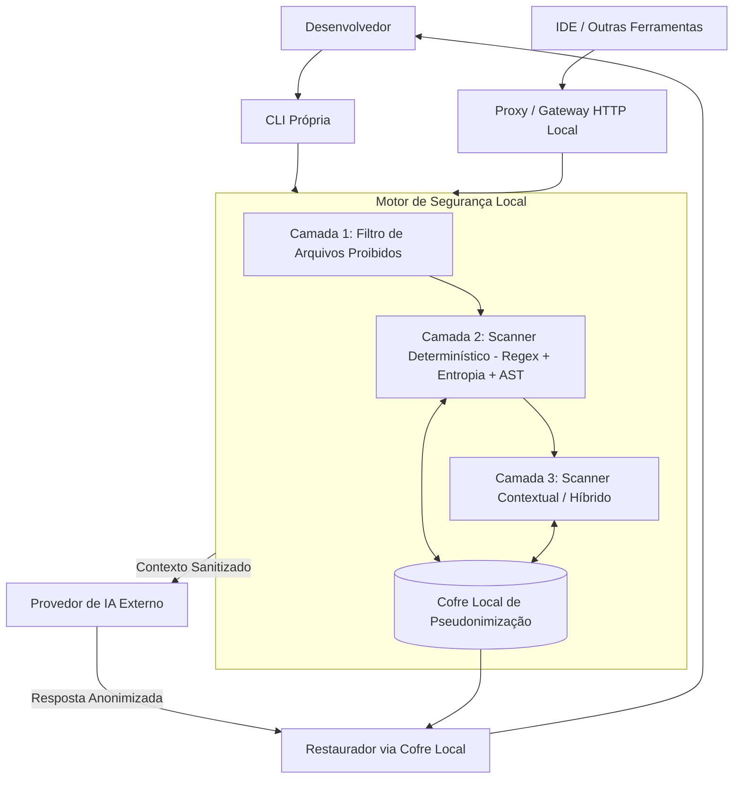

# blind-ai

> Motor híbrido de segurança e privacidade (CLI + Proxy/Gateway local) para desenvolvimento assistido por IA de terceiros sem vazamento de credenciais, arquitetura interna ou dados sensíveis.

## Problema

Engenheiros de software precisam enviar contexto de código para modelos de linguagem externos (LLMs) para depurar, refatorar e desenvolver mais rápido. Porém, esse fluxo cria riscos críticos de **vazamento de dados corporativos**:

- Chaves de API, tokens, senhas e arquivos `.env`.
- Caminhos internos de diretórios, nomes de servidores e endereços IP privados.
- Nomes de módulos proprietários, regras de negócio e dados sensíveis em comentários ou logs.

## Visão da Arquitetura

O `blind-ai` adota uma arquitetura modular de **Defesa em Profundidade**, onde um único núcleo de segurança (`core`) atende tanto uma **CLI própria** quanto um **Proxy/Gateway HTTP local**:



## Instalação

O `blind-ai` requer **Python >= 3.12** e possui **zero dependências externas** (100% biblioteca padrão do Python):

```bash
pip install -e .
```

Após a instalação, o comando `blind-ai` (ou `python -m blind_ai`) fica disponível no terminal.

## Guia de Uso

### Fluxo 1 — CLI de Empacotamento Seguro (`pack` / `restore` e `scan`)

Ideal para preparar o contexto de um repositório inteiro antes de enviar a qualquer LLM (chat web, CLI ou API) e restaurar a resposta localmente com integridade sintática:

1. **Empacotar e sanitizar o repositório com cofre cifrado:**

   ```bash
   blind-ai pack . \
     -o context_bundle.md \
     --vault .blind_session.vault \
     --passphrase "sua-senha-forte"
   ```

   - Bloqueia automaticamente arquivos sensíveis (`.env`, chaves privadas, certificados, binários e padrões extras do `.blindai.toml`).
   - Substitui segredos, IPs privados, caminhos internos e termos proprietários por placeholders determinísticos (`__BLIND_*__`), mantendo consistência entre todos os arquivos.
   - Use `--json` para obter o resumo estruturado da execução.

2. **Restaurar o código retornado pela IA usando o cofre local:**

   ```bash
   blind-ai restore resposta_ia.py \
     --vault .blind_session.vault \
     --passphrase "sua-senha-forte" \
     -o codigo_restaurado.py
   ```

3. **Auditoria pré-commit e sanitização pontual:**

   ```bash
   # Escanear apenas arquivos staged no git e falhar (exit code 1) se houver vazamentos
   blind-ai scan --staged --strict

   # Sanitizar um arquivo ou stdin isoladamente
   blind-ai sanitize app.py --vault session.vault --passphrase "sua-senha-forte" -o app.sanitized.py

   # Executar o benchmark sintético (métricas H1)
   blind-ai benchmark --format json
   ```

### Fluxo 2 — Proxy/Gateway HTTP Local para IDEs (`blind-ai proxy`)

Para integração transparente com IDEs e clientes compatíveis com a API OpenAI (`/v1/chat/completions`, com suporte a JSON e streaming SSE):

```bash
blind-ai proxy \
  --port 8765 \
  --auth-token "meu-token-local" \
  --upstream-url "http://127.0.0.1:11434/v1" \
  --session-ttl 3600
```

Configure sua IDE ou cliente para apontar o `Base URL` para `http://127.0.0.1:8765/v1` com header `Authorization: Bearer meu-token-local`. O gateway sanitiza automaticamente as mensagens enviadas ao provedor upstream e restaura os placeholders na resposta recebida.

Endpoints locais disponíveis:
- `GET /health` — verificação de saúde do servidor local.
- `POST /v1/chat/completions` — gateway compatível com OpenAI (JSON e SSE streaming).
- `POST /v1/sanitize`, `POST /v1/restore`, `POST /v1/echo` — endpoints diretos de sanitização e restauração por sessão.

## Configuração (`.blindai.toml`)

Crie um arquivo `.blindai.toml` na raiz do projeto (descoberto automaticamente pelos comandos da CLI ou informado via `--config`):

```toml
# Termos de negócio, codinomes ou módulos proprietários a pseudonimizar
proprietary_terms = [
  "ProjectHelios",
  "NexusLedgerEngine",
]

# Valores explicitamente permitidos (ignorados pelo scanner)
allowlist_values = [
  "127.0.0.1",
  "example_public_token",
]

# Padrões adicionais de arquivos bloqueados pela Camada 1
extra_blocked_files = [
  "*.bak",
  "secrets/*.json",
]

# Regras regex customizadas do projeto
[rules]
internal_ticket = "ACME-[0-9]{5}"
corp_service_id = "svc_[a-z0-9]{12}"
```

## Estrutura do Projeto

```text
blind-ai/
├── docs/
│   └── 01-pesquisa-e-hipoteses.md   # Pesquisa de mercado, método científico e métricas
├── src/
│   └── blind_ai/
│       ├── core/                    # Scanner, FileFilter, Vault, SecureVault, Packer, Config, Benchmark
│       ├── cli/                     # CLI (`scan`, `sanitize`, `restore`, `pack`, `proxy`, `benchmark`)
│       └── proxy/                   # Proxy/Gateway HTTP local compatível com OpenAI
├── tests/                           # Testes unitários, adversariais e E2E
├── pyproject.toml                   # Empacotamento Python >= 3.12 (zero deps externas)
├── .gitignore
└── README.md
```

## Status Atual

- [x] Fase 0: Pesquisa de mercado, definição do problema, hipóteses científicas e estrutura inicial.
- [x] Fase 1: Dataset sintético de avaliação (*benchmark*) e Camada 1/2 (Filtro de arquivos + Scanner determinístico + Cofre local).
- [x] Fase 2: CLI própria (`blind-ai scan`, `sanitize`, `restore`, `pack`, `benchmark`) e configuração `.blindai.toml`.
- [x] Fase 3: Experimento científico — Scanner determinístico vs. contextual/híbrido e benchmark adversarial.
- [x] Fase 4: Proxy/Gateway HTTP local (`/v1/chat/completions` com JSON/SSE, auth Bearer, TTL de sessão e limites de payload).
- [x] Fase 5: Cofre cifrado autenticado (`--passphrase`), empacotamento de contexto multi-arquivo (`ContextPacker`) e auditoria `--staged --strict`.
- [x] Fase 6: Validação E2E ponta a ponta (`pack` -> 0 vazamentos -> `restore` executável) e documentação v1.0.

## Documentação

- [01 — Pesquisa de Mercado, Hipóteses e Plano Experimental](docs/01-pesquisa-e-hipoteses.md)
